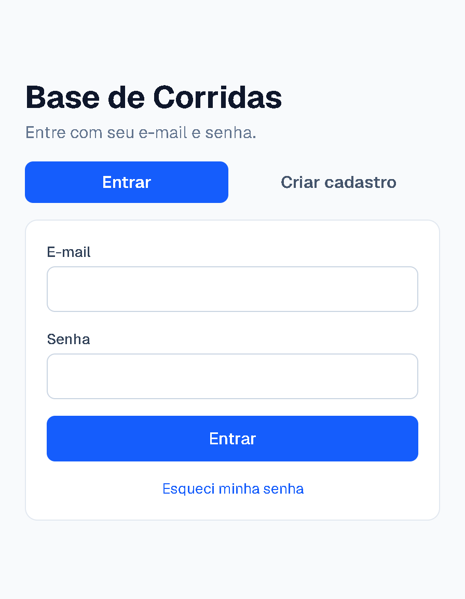
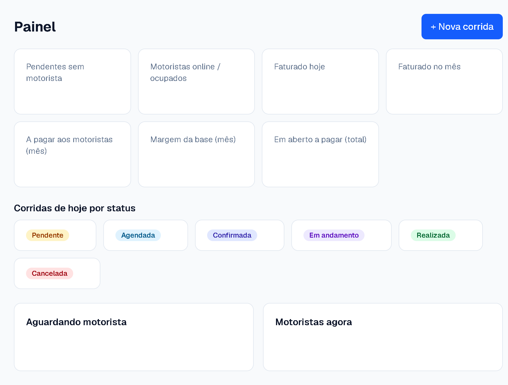
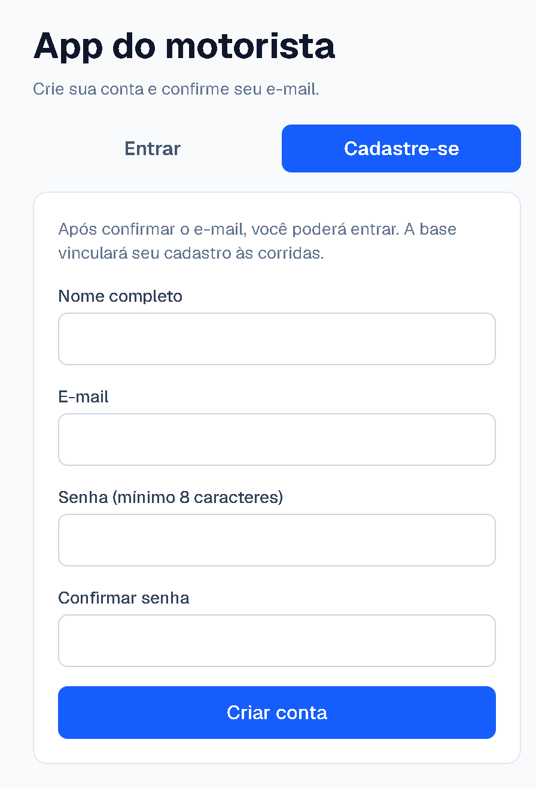
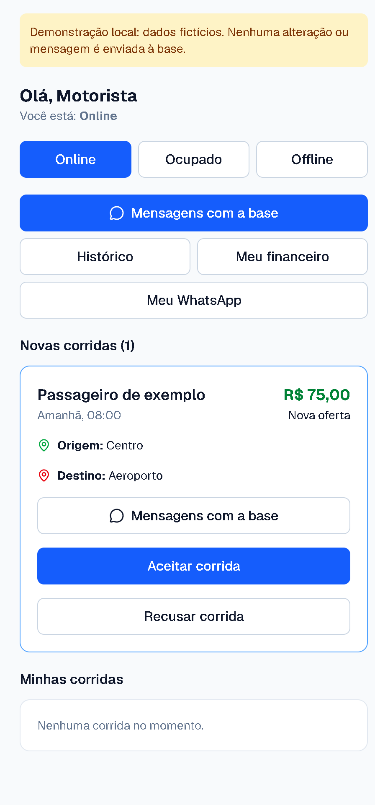
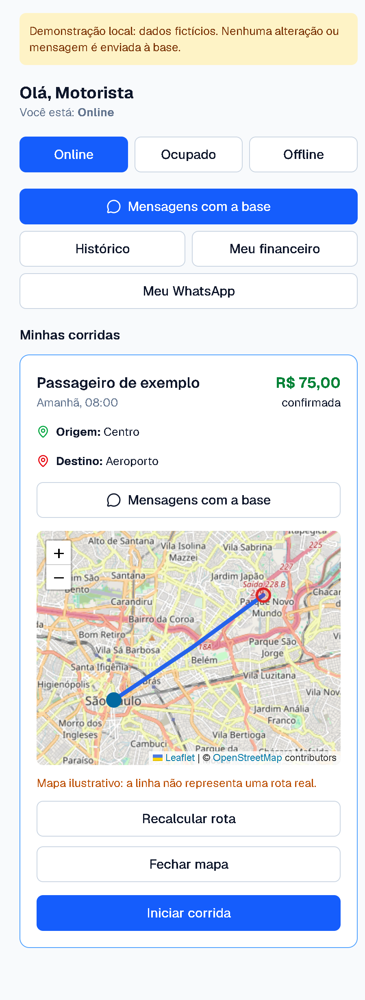
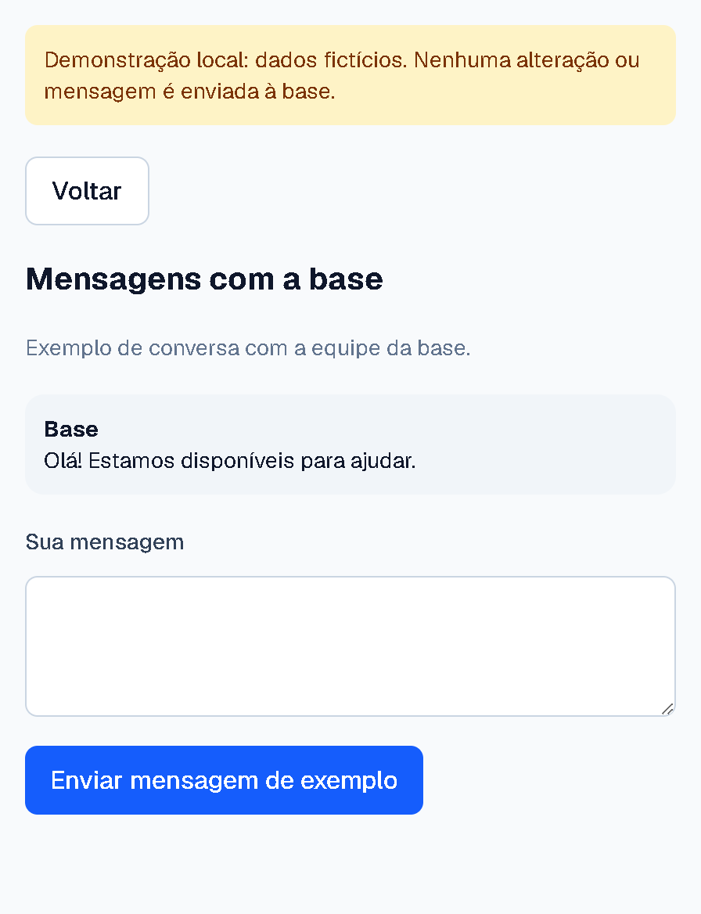
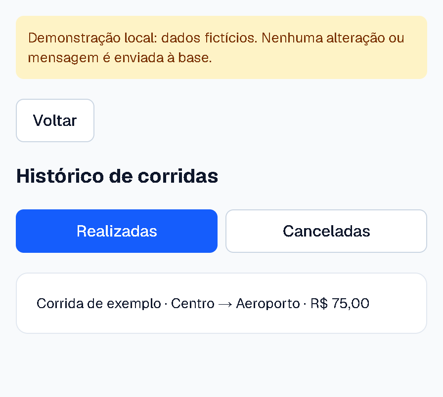

# Sistema de Gestão de Corridas — Fase 1

Next.js 16 + TypeScript + Tailwind + Supabase.

### Apresentação em vídeo

[Assista à apresentação do sistema](docs/apresentacao-sistema.mp4) — vídeo narrado de aproximadamente 2 min 48 s.

### Acesso à base

Tela de entrada e cadastro da equipe:



### Painel da base

Visão geral de indicadores, corridas do dia e motoristas ativos:



## Configuração

1. Crie um projeto em https://supabase.com.
2. No **SQL Editor**, execute em ordem: `supabase/migrations/0001_schema.sql` e `supabase/migrations/0002_cron.sql`. O `0002` precisa da extensão pg_cron, que é ativada em Database > Extensions.
3. Em **Authentication > Users**, crie três usuários (marque "Auto confirm"):
   - `admin@base.test`
   - `operador@base.test`
   - `motorista@base.test`
4. Execute `supabase/seed.sql`. Ele promove os papéis e cria clientes, motoristas e corridas de exemplo.
5. Copie `.env.example` para `.env.local` e preencha a URL e a anon key do projeto.
6. Rode:

```
npm install
npm run dev
npm test
```

## Checklist de teste

- Entrar como admin: painel com indicadores, clientes, motoristas e corridas.
- Criar uma corrida em `/corridas/nova`: o repasse é sugerido e há aviso de conflito de horário.
- Atribuir um motorista, aceitar/iniciar/finalizar e ver o histórico de status.
- Entrar como operador: não vê PIX nem taxa de repasse dos motoristas.
- Entrar como motorista: vê somente as próprias corridas.
- Busca global no topo e corridas recorrentes em `/recorrentes`.

## Fase 2 — App do motorista (PWA), push e tempo real

1. Execute `supabase/migrations/0003_realtime_push.sql` no SQL Editor.
2. Gere as chaves de push: `npx web-push generate-vapid-keys`. Preencha no `.env.local`: `NEXT_PUBLIC_VAPID_PUBLIC_KEY`, `VAPID_PRIVATE_KEY`, `VAPID_SUBJECT` e `SUPABASE_SERVICE_ROLE_KEY` (Project Settings > API; nunca publique essa chave).
3. Reinicie o `npm run dev`. Push exige HTTPS (`localhost` funciona; no celular use a URL da Vercel).

### Checklist
- Motorista, no celular: abra `/motorista`, toque em "Ativar notificações" e instale o app ("Adicionar à tela inicial").
- Operador/admin: atribua uma corrida ao motorista; chega a notificação e o card "Nova corrida" aparece sozinho.
- Motorista aceita/recusa (com motivo)/inicia/finaliza; o painel da base muda sem recarregar.
- Botões de ligar, WhatsApp, Google Maps e Waze no card da corrida confirmada.
- Deixe uma corrida enviada sem resposta por mais de 10 min (`settings.driver_response_timeout_minutes`): aparece o alerta amarelo no topo do painel.

### Portal do motorista e mensagens

- Aplique as migrações anteriores em ordem e, em seguida, `supabase/migrations/0011_driver_portal.sql`, `0012_driver_signup.sql` e `0013_driver_phone.sql`. A `0011` habilita vínculo, conversas e regras de acesso; a `0012` permite cadastro de motorista e mantém novos operadores inativos até aprovação.
- **Antes de liberar novos cadastros**, aplique e valide as migrações: a `0010` sozinha cria operadores ativos. No Supabase Authentication, mantenha **Confirm email** habilitado. A chave `SUPABASE_SERVICE_ROLE_KEY` é necessária no servidor para o limite de cadastros.
- Para testar no próprio computador com o template padrão, use `http://localhost:3000` como Site URL e adicione `http://localhost:3000/auth/callback?next=/motorista` às Redirect URLs. Abra o link de confirmação no mesmo navegador do cadastro; se isso não for possível, confirme o e-mail e entre pela tela de login. O serviço de e-mail padrão do Supabase envia apenas para endereços autorizados da equipe do projeto e possui limite reduzido; configure SMTP próprio para outros destinatários.
- Para acesso pelo celular ou uso público, configure HTTPS público, Site URL e Redirect URLs correspondentes e SMTP próprio. Para usar o fluxo alternativo por token hash, configure o template **Confirm signup** com `<a href="{{ .SiteURL }}/auth/confirm?token_hash={{ .TokenHash }}">Confirmar e-mail</a>`. Teste a entrega e a confirmação antes de disponibilizar o sistema.
- O motorista usa **Cadastre-se** em `/motorista/login` e confirma o e-mail recebido. Ele pode entrar após a confirmação, mas não recebe corridas até o administrador vincular sua conta confirmada em **Motoristas → editar motorista → Acesso ao aplicativo**. O vínculo altera o papel para motorista; não escolha uma conta que precise continuar sendo operador.
- Novos operadores continuam precisando de ativação pelo administrador em `/usuarios`. Aprovação de operadores por e-mail ainda não foi implementada.
- O motorista entra em `/motorista/login`. Em um endereço HTTPS público, pode adicionar o aplicativo à tela inicial pelo navegador. `localhost` permite apenas teste no próprio computador.
- A tela inicial mostra ofertas e corridas em andamento; **Histórico** separa realizadas e canceladas. O motorista vê somente suas próprias corridas.
- Cada envio de corrida tem uma conversa separada: o motorista toca em **Mensagens com a base** e a equipe responde em **Mensagens**, ou pelo histórico de envios da corrida. A troca de motorista cria uma conversa diferente.
- As conversas atualizam enquanto a tela está aberta. Push para novas corridas e mensagens da base depende das chaves VAPID, de HTTPS, de suporte do aparelho e da autorização do motorista; não substitui a consulta ao aplicativo.
- Aplique também `supabase/migrations/0015_driver_general_messages.sql` para habilitar **Mensagens com a base** sem depender de uma corrida, inclusive antes do vínculo. A equipe responde em **Mensagens → Conversas gerais**. A conversa é compartilhada com a equipe, não com outros motoristas.
- O login do app aceita somente contas de motorista. Abas no mesmo navegador compartilham a sessão; para usar simultaneamente uma conta de motorista e outra da base, utilize navegadores ou perfis separados.
- Em desenvolvimento, `http://localhost:3000/motorista/demo` mostra uma demonstração sem login e com dados fictícios. As interações ficam apenas na tela e não enviam dados à base; a demonstração não está disponível em produção.
- Após aceitar uma corrida, o motorista pode abrir um mapa da posição atual até o destino. Configure `OPENROUTESERVICE_API_KEY` no servidor com uma chave de https://openrouteservice.org/ e `SUPABASE_SERVICE_ROLE_KEY` para o limite de consultas. Configure também `NEXT_PUBLIC_MAP_TILE_URL` com a URL HTTPS de um fornecedor de imagens de mapa baseado em OSM que permita esse uso, contendo `{z}`, `{x}` e `{y}`, e `NEXT_PUBLIC_MAP_TILE_ATTRIBUTION` com a atribuição adicional exigida pelo fornecedor. As variáveis `NEXT_PUBLIC_` são públicas: use apenas chaves próprias para navegador. Reinicie o servidor e refaça o build após alterá-las. Sem configuração, use os links Google Maps ou Waze. Geolocalização no celular exige HTTPS e permissão do motorista; `localhost` permite testes no próprio computador.
- O endereço do destino e a localização são enviados ao openrouteservice para calcular a rota, e as imagens são carregadas do fornecedor configurado. Informe os motoristas e observe as políticas de privacidade, uso e limites dos provedores. A posição é atualizada apenas com o mapa aberto; a linha não é recalculada automaticamente, não há navegação por voz e o endereço encontrado deve ser conferido. A demonstração usa imagens públicas do OpenStreetMap e mostra apenas uma linha ilustrativa, não uma rota real.

#### Telas do motorista

**Cadastro:** a conta precisa de confirmação de e-mail e vínculo com a base para receber corridas.



As telas abaixo mostram a demonstração local com dados fictícios; nenhuma mensagem ou alteração é enviada à base.

**Corridas:** oferta de exemplo no painel do motorista.



**Mapa:** exemplo após aceitar uma corrida. A linha exibida é ilustrativa, não uma rota real.



**Mensagens com a base:** conversa de exemplo.



**Histórico:** filtro de corridas realizadas e canceladas.



### Lista de motoristas e confirmação de WhatsApp

- Aplique também `supabase/migrations/0013_driver_phone.sql` depois da `0012`. Em **Motoristas**, a equipe consulta nome, e-mail e telefone dos ativos. Somente administradores podem cadastrar, inativar ou reativar motoristas. Inativar preserva o histórico e impede novas atribuições e o acesso às corridas; confira e reatribua manualmente as corridas que estiverem em andamento.
- Em **Meu WhatsApp**, o motorista com e-mail confirmado informa um celular brasileiro com DDD e confirma o código recebido. A opção também aparece antes do vínculo com a base. O número confirmado é atualizado no cadastro vinculado; se o vínculo acontecer depois, ele é copiado ao vincular. O e-mail do perfil preenche o cadastro apenas quando estiver vazio.
- Para enviar códigos de verdade, configure no servidor `WHATSAPP_ACCESS_TOKEN`, `WHATSAPP_PHONE_NUMBER_ID`, `WHATSAPP_API_VERSION`, `WHATSAPP_AUTH_TEMPLATE`, `WHATSAPP_AUTH_LANGUAGE` e `DRIVER_PHONE_OTP_SECRET` (segredo aleatório exclusivo de pelo menos 32 caracteres), além de `SUPABASE_SERVICE_ROLE_KEY`. Na Meta, use um número empresarial e um template de autenticação aprovado com botão **copiar código**, prazo de 10 minutos e idioma igual ao configurado. O envio pode ter custo; obtenha o consentimento do motorista e teste com um número autorizado. A aceitação pela API não garante a entrega da mensagem.
- Códigos expiram após 10 minutos e permitem até cinco tentativas; novos envios têm limite por conta e por número. Sem migração ou configuração a confirmação não funciona e um número anterior permanece inalterado.

## Fase 3 — Financeiro

Execute no SQL Editor, em ordem: `supabase/migrations/0004_finance.sql` e `supabase/migrations/0005_storage.sql` (bucket privado `receipts` para comprovantes).

Como testar (logado como admin):
1. Em **Financeiro > Novo fechamento**, escolha motorista, período (semanal/quinzenal/mensal) e data inicial; confira o resumo e crie o fechamento.
2. Abra o fechamento: lance um desconto e um acréscimo (a justificativa é obrigatória).
3. Registre um pagamento parcial com comprovante: o status vira "Parcial". Pague o saldo: vira "Pago".
4. **Faturamento por cliente**: escolha o período e clique no cliente para ver as corridas a cobrar.
5. Entre como motorista, abra **Meu financeiro** e veja só os seus fechamentos.
6. Entre como operador: o menu Financeiro não aparece e o acesso é bloqueado.
7. Finalize uma corrida: o repasse é lançado automaticamente.

O bucket de comprovantes (0005) só pode ser testado no Supabase real.

## Fase 4 — Relatórios, exportação e Google Sheets

Execute no SQL Editor: `supabase/migrations/0006_reports.sql` (relatórios, fila `jobs`, envio agendado e fila do Sheets).

### Configuração (variáveis de ambiente na Vercel / `.env.local`)
- `SUPABASE_SERVICE_ROLE_KEY` e `CRON_SECRET` (qualquer texto longo e aleatório). O `vercel.json` chama `/api/cron/tick` a cada 5 minutos; a Vercel envia o `CRON_SECRET` automaticamente. No plano Hobby o cron só roda 1x por dia: use o plano Pro ou chame a URL de outro agendador com o cabeçalho `Authorization: Bearer <CRON_SECRET>`.
- **E-mail** (Resend): `RESEND_API_KEY` e `EMAIL_FROM` (domínio verificado).
- **Google Sheets**: crie uma conta de serviço no Google Cloud, ative a API Google Sheets, compartilhe a planilha com o e-mail da conta (editor) e preencha `GOOGLE_SERVICE_ACCOUNT_EMAIL`, `GOOGLE_PRIVATE_KEY` (a chave inteira, com `\n`) e `GOOGLE_SHEETS_ID` (o trecho da URL entre `/d/` e `/edit`).

### Como testar (admin, menu **Relatórios**)
1. Alterne Diário / Semanal / Mensal e a data de referência: veja realizadas, canceladas, faturado, repasse e margem, por dia, motorista e cliente.
2. **Exportar planilha**: baixe .xlsx (abas Consolidado, Por dia, uma por motorista e uma por cliente) ou CSV (abre direto no Excel pt-BR).
3. **Envio automático**: agende um relatório e clique em "enviar agora". O e-mail com o .xlsx chega após o próximo ciclo do cron.
4. **Google Sheets**: finalize uma corrida; em até 5 minutos surge uma linha nas abas Consolidado, do motorista e do cliente. Use "Sincronizar" para enviar corridas antigas (não duplica as já enviadas).
5. Operador: o menu Relatórios não aparece e o banco bloqueia as consultas.

Tarefas em segundo plano ficam na tabela `jobs` (até 5 tentativas com espera crescente; `status = 'failed'` indica problema de credencial).

## Fase 5 — Leitura de mensagens por IA, WhatsApp Business e e-mail

Rode a migração `0007_inbound.sql`.

### Configuração
- **IA**: `OPENAI_API_KEY` (opcional `OPENAI_MODEL`, `OPENAI_BASE_URL`). Sem a chave, o sistema segue funcionando com cadastro manual.
- **WhatsApp**: no Meta for Developers, produto WhatsApp, Configuração do webhook: URL `https://SEU-DOMINIO/api/webhooks/whatsapp`, token de verificação = `WHATSAPP_VERIFY_TOKEN`, assine o campo `messages`. Coloque o App Secret em `WHATSAPP_APP_SECRET` (as chamadas são validadas por assinatura HMAC).
- **E-mail**: configure o inbound do provedor (ex.: Postmark Inbound) para fazer POST em `https://SEU-DOMINIO/api/webhooks/email` com o cabeçalho `Authorization: Bearer <EMAIL_WEBHOOK_SECRET>` (ou `?secret=`). Aceita o JSON do Postmark (`MessageID`, `From`, `Subject`, `TextBody`) ou `{ id, from, subject, text }`. Para IMAP, use um pequeno serviço que repasse cada e-mail a esse endereço.
- Os webhooks têm limite de requisições por IP, limite de tamanho e deduplicação por ID da mensagem. A leitura por IA roda na fila (o cron da Fase 4).

### Como testar
1. **Nova corrida → Colar mensagem**: cole um pedido, clique em *Preencher com IA*, revise e salve. A corrida fica com origem "ai_paste" e guarda a mensagem original.
2. **Webhook de e-mail** (sem provedor): `curl -X POST https://SEU-DOMINIO/api/webhooks/email -H "Authorization: Bearer SEGREDO" -H "content-type: application/json" -d '{"id":"t1","from":"rh@empresa.com","subject":"Corrida","text":"Amanhã 8h, Ana Souza, Av. Paulista 1000 para Aeroporto de Guarulhos. R$ 150"}'`.
3. Menu **Entrada**: a mensagem aparece (após o próximo ciclo do cron) com os dados lidos. *Criar corrida* abre o formulário preenchido; ao salvar, a mensagem vira "Corrida criada". *Ignorar* descarta.
4. Motorista não acessa a Entrada; o banco bloqueia a leitura.

## Fase 6 — Endurecimento

Rode a migração `0008_hardening.sql`.

## Aprovação de operadores
As migrações `0009_signup_approval.sql` e `0010_signup_open.sql` são históricas. Após aplicar também a `0012_driver_signup.sql`, novos operadores são criados inativos e o administrador os aprova em `/usuarios`. O primeiro administrador precisa ser ativado via SQL.

- A área **Administrador** (`/administrador`) reúne a aprovação de usuários e atalhos administrativos. As aprovações atualizam o banco e são auditadas. Contas desativadas aparecem junto com novos cadastros inativos, pois o banco não distingue essas situações.
- A liberação por senha compartilhada é opcional e deve ser ativada após preparar o servidor e aplicar `0014_admin_session.sql`. Com ela ativa, qualquer operador ou administrador ativo pode liberar suas funções administrativas até sair da conta; motoristas não podem. A liberação vale somente para a sessão autenticada e é registrada na auditoria. A senha é compartilhada, portanto quem a conhece pode conceder privilégios e alterar dados sensíveis. Uma senha curta ou previsível é insegura mesmo com limites de tentativas; use uma senha forte antes de publicar o sistema.
- No servidor, configure `SUPABASE_SERVICE_ROLE_KEY` e `ADMIN_ACCESS_PASSWORD_HASH`. Para gerar o hash no PowerShell, sem colocar a senha no código ou no histórico de comandos:

```powershell
$env:SENHA_ADMIN_TEMP = [System.Net.NetworkCredential]::new('', (Read-Host 'Senha administrativa' -AsSecureString)).Password
node -e "const c=require('node:crypto'),s=c.randomBytes(16);console.log(['scrypt',s.toString('hex'),c.scryptSync(process.env.SENHA_ADMIN_TEMP,s,32).toString('hex')].join(':'))"
Remove-Item Env:\SENHA_ADMIN_TEMP
```

  Guarde o resultado como segredo em `ADMIN_ACCESS_PASSWORD_HASH` (não no repositório). Faça backup, aplique as migrações anteriores em ordem e depois `0014_admin_session.sql`; configure `ADMIN_SESSION_ACCESS_ENABLED=1` e reinicie a aplicação imediatamente. A migração altera a autorização no banco: até ativar a aplicação configurada, funções administrativas ficarão bloqueadas. Com a opção desativada e antes da migração, permanece a regra anterior baseada no papel de administrador.
- Ao trocar a senha compartilhada, atualize o hash em todas as instâncias e reinicie-as. Para revogar sessões já liberadas, execute `delete from public.admin_access_sessions;` no SQL Editor; sem isso elas continuam liberadas até o usuário sair. O cadastro público e o HTTPS têm suas próprias pendências descritas acima.
- **Configurações** (admin): prazo de resposta do motorista (1 a 240 min). A alteração é auditada.
- **Auditoria** (admin): quem fez o quê e quando, com filtro por tabela e paginação; mostra os campos alterados.
- **Cache do painel**: os números do painel ficam em cache por 30 segundos (por perfil). O RLS continua valendo.
- **Rate limiting**: login (10 por 5 min por IP), recuperação de senha (5 por 10 min) e webhooks. Exige `SUPABASE_SERVICE_ROLE_KEY`; sem ela o limite fica desativado.
- **Sentry**: preencha `SENTRY_DSN` e `NEXT_PUBLIC_SENTRY_DSN` para registrar erros do servidor e do navegador.
- **Cabeçalhos de segurança** em todas as páginas (nosniff, frame deny, HSTS, referrer).
- **Backup diário**: `.github/workflows/backup.yml` gera um `pg_dump` às 03:00 (Brasília) e guarda por 30 dias. Crie o secret `BACKUP_DATABASE_URL` (string de conexão do Supabase) no GitHub. Ative também o backup nativo do Supabase (plano Pro).

### Como testar
1. Admin: Configurações → altere o prazo e salve; veja o registro em Auditoria.
2. Faça 11 logins errados seguidos: aparece "Muitas tentativas".
3. Operador: Auditoria e Configurações não aparecem no menu e o acesso direto redireciona.
